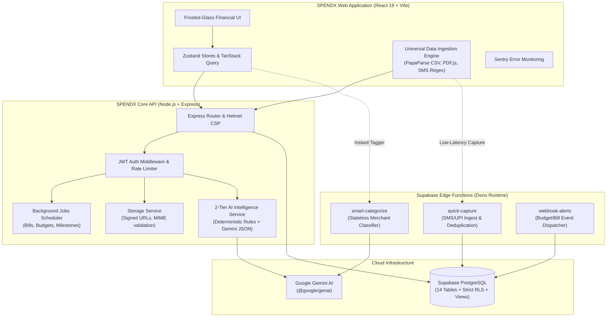

# SPENDX — AI-Powered Personal Finance Management Platform

[](https://www.typescriptlang.org/)
[](https://react.dev/)
[](https://vitejs.dev/)
[](https://tailwindcss.com/)
[](https://expressjs.com/)
[](https://nodejs.org/)
[](https://vitest.dev/)
[](LICENSE)

---

## 1. Project Overview & Tagline
**SPENDX** — *Your Money. Your Intelligence.*

SPENDX is a production-grade, privacy-centric, AI-powered personal finance management ecosystem. Engineered as two decoupled, independently deployable systems—a reactive Vite/React SPA and a hardened Express/Node API microservice—SPENDX delivers continuous financial awareness, automatic statement ingestion, recurring payment tracking, financial health diagnostics, proactive background alerts, and conversational AI coaching.

---

## 2. Core Functional Modules

| Module | Route | Key Capabilities |
|---|---|---|
| **Executive Dashboard** | `/` | Net worth metrics, cash flow trends, budget health, savings velocity, upcoming bills, AI pulse |
| **Financial Ledger** | `/transactions` | Multi-account ledger, merchant categorization, search, date filters, universal data capture |
| **Automatic Ingestion** | Modal (`/transactions`) | CSV, Excel, PDF Text & Indian Bank SMS parsers, column mapper, 24h deduplication |
| **Account Vault** | `/accounts` | Bank, savings, credit cards, cash accounts, net worth calculation, transfer modal |
| **Budget Discipline** | `/budgets` | Category spending caps, utilization meters, overrun warnings, status indicators |
| **Savings Milestones** | `/savings` | Goal progress tracking, contribution ledger, milestone celebrations (50%, 100%) |
| **Financial Analytics** | `/analytics` | Income vs expense burn rate, category heatmaps, account liquidity distribution |
| **Recurring Commitments** | `/recurring` | Subscription schedules, frequency tracking, upcoming calendar, smart pattern detector |
| **Advisory & Insights** | `/insights` | 4-Pillar Financial Health Score (0-100), high-impact recommendations, bookmarking |
| **Reports & Statements** | `/reports` | Monthly account statements, RFC 4180 CSV export, tax deductions (80D/80E/80GG), print preview |
| **AI Financial Coach** | `/ai-assistant` | Grounded Gemini financial assistant, contextual prompt chips, advice cards |

---

## 3. Technology Stack

### Frontend Architecture
- **Framework**: React 19 + Vite 6 + TypeScript 5.7
- **Styling**: Tailwind CSS v4, Lucide React, Motion for React
- **Design Tokens**: Ice Blue (`#DDF5FF`), Soft Lavender (`#DCD9FF`), Primary Indigo (`#718FE8`), Deep Slate (`#263653`)
- **State Management**: TanStack Query v5 + Zustand
- **Forms & Validation**: React Hook Form + Zod v3
- **Visualization**: Recharts + Sonner notifications
- **Ingestion & Parsing**: PapaParse (RFC 4180 CSV) + PDF.js (`pdfjs-dist`) for client-side statement text extraction + Indian Bank SMS regex engine
- **Error Monitoring**: Sentry (`@sentry/react`) with graceful fallback
- **Testing**: Vitest + React Testing Library + JSDOM (14 test suites, 89 passed) + Playwright E2E (`e2e/spendx.spec.ts`)

### Hybrid Backend Architecture
1. **Core API Microservice (`/backend`)**:
   - **Runtime**: Node.js LTS + Express 4.21 + TypeScript 5.7
   - **Database & Auth**: Supabase PostgreSQL with Row Level Security (RLS)
   - **AI Intelligence**: 2-Tier engine (Deterministic rules + Google Gemini `@google/genai` Structured JSON fallback with Zod validation)
   - **Security & Reliability**: Helmet, CORS, express-rate-limit, Pino logging, Sentry (`@sentry/node`)
   - **Storage**: Secure user-scoped file & receipt uploads with 15-minute signed URLs
   - **Background Automation**: In-memory interval scheduler with graceful shutdown hooks
   - **Testing**: Vitest + Supertest (6 test suites, 48 passed)

2. **Supabase Edge Functions (`/supabase/functions` — Deno Runtime)**:
   - **`quick-capture`**: Ultra-low-latency raw SMS/UPI/notification ingest, instant regex parsing, 24h deduplication, `capture_events` audit logging.
   - **`smart-categorize`**: Stateless merchant & category enrichment with rule-engine fast-path and Gemini fallback.
   - **`webhook-alerts`**: Event-driven alert dispatcher enforcing `notification_preferences` for budget overruns (>80%, 100%), recurring bills, and savings milestones.

---

## 4. System Architecture



---

## 5. Database Schema & Migration Execution Order

All database migrations reside in `backend/src/db/migrations/` and must be executed in order:

1. **`001_initial_schema.sql`**:
   - Creates 14 core entities: `profiles`, `accounts`, `categories`, `transactions`, `budgets`, `savings_goals`, `savings_contributions`, `recurring_payments`, `financial_insights`, `capture_events`, `notifications`, `chat_sessions`, `chat_messages`, `reports`.
   - Provisions 11 high-performance B-Tree composite indexes for instant query response times.

2. **`002_row_level_security.sql`**:
   - Enables `ROW LEVEL SECURITY` across all 14 tables.
   - Enforces strict tenant isolation: users can only query and mutate records where `auth.uid() = user_id`.
   - Allows shared read access for system default categories (`is_system = true`).

3. **`003_audit_triggers.sql`**:
   - Provisions `set_updated_at()` trigger for automated modification tracking.
   - Adds unique constraint `uq_transactions_ref_number` on `transactions(user_id, account_id, reference_number)` to prevent duplicate imports.
   - Provisions `handle_new_user()` trigger on `auth.users` to automatically seed user profile and default category dictionary upon registration.

4. **`004_hybrid_alignment.sql`**:
   - Adds `notification_preferences` table for edge alert dispatch rules.
   - Creates composite B-Tree indexes on `transactions(user_id, date DESC)`, `budgets(user_id, category)`, and `capture_events(user_id, created_at DESC)`.
   - Establishes `recurring_transactions` standard view alias for cross-system query compatibility.
   - Enforces tenant-isolated RLS policies across all newly provisioned structures.

---

## 6. API Reference & Endpoints

### Health & Monitoring
- `GET /api/v1/health` — Service liveness check (200 OK)
- `GET /api/v1/health/ready` — Readiness probe (memory usage, scheduler state, database status)

### Financial Transactions & Ledger
- `GET /api/v1/transactions` — Paginated and filtered transaction ledger
- `POST /api/v1/transactions` — Record new transaction (requires JWT, validates amount, 24h duplicate check)
- `POST /api/v1/transactions/batch` — Bulk transaction batch ingest
- `GET /api/v1/transactions/:id` — Retrieve transaction details
- `PATCH /api/v1/transactions/:id` — Update transaction metadata
- `DELETE /api/v1/transactions/:id` — Remove transaction from ledger

### Budgets & Utilization Monitoring
- `GET /api/v1/budgets` — Retrieve monthly category budget caps and current utilization
- `POST /api/v1/budgets` — Create new category budget allocation
- `PATCH /api/v1/budgets/:id` — Modify budget cap or alert threshold
- `DELETE /api/v1/budgets/:id` — Delete budget allocation
- `POST /api/v1/budgets/check-thresholds` — Trigger threshold check (>80% warning, 100% breach notifications)

### Savings Goals & Milestones
- `GET /api/v1/savings` — List savings targets and progress metrics
- `POST /api/v1/savings` — Initialize new savings goal
- `PATCH /api/v1/savings/:id` — Update target amount or target date
- `DELETE /api/v1/savings/:id` — Delete savings goal
- `POST /api/v1/savings/:id/contributions` — Record contribution deposit and evaluate milestones (50%, 100%)

### Analytics & Financial Health
- `GET /api/v1/analytics/summary` — Net worth, income, expense, and savings rate summary
- `GET /api/v1/analytics/health-score` — Deterministic 4-pillar Financial Health Score (0-100)
- `GET /api/v1/analytics/burn-rate` — Expense burn rate, monthly run-rate, and runway projection

### Statement Ingestion
- `POST /api/v1/import/validate` — Validate raw CSV/PDF parsed records against schema
- `POST /api/v1/import/commit` — Commit validated transaction batch and write audit log
- `GET /api/v1/import/history` — Fetch recent import capture event history

### AI Intelligence & Advisory
- `GET /api/v1/ai/status` — Gemini AI integration readiness
- `GET /api/v1/ai/insights` — Retrieve personalized AI financial recommendations
- `POST /api/v1/ai/coach` — Ask conversational financial coach
- `POST /api/v1/ai/categorize` — Hybrid merchant & category classification (Structured JSON)
- `POST /api/v1/ai/monthly-summary` — Deterministic statistics with AI narrative analysis

### Scheduled Notifications & Background Automation
- `GET /api/v1/notifications` — Retrieve notifications & unread count
- `PATCH /api/v1/notifications/:id/read` — Mark notification as acknowledged

### Secure Financial Document Storage
- `POST /api/v1/storage/upload-url` — Request short-lived signed upload URL (validated MIME & size <= 5MB)
- `POST /api/v1/storage/download-url` — Generate 15-minute signed download URL (cross-tenant protected)
- `POST /api/v1/storage/register` — Register uploaded receipt in user ledger
- `GET /api/v1/storage/documents` — List user stored receipts and statements

---

## 7. Local Development Setup

### Prerequisites
- Node.js >= 20.x (v26 LTS recommended)
- npm >= 10.x
- Git

### Installation
```bash
# Clone the repository
git clone https://github.com/void-dev01/SpendX.git
cd SpendX

# Install frontend dependencies
cd frontend
npm install

# Install backend dependencies
cd ../backend
npm install
```

### Environment Configuration
1. **Frontend (`frontend/.env`)**:
   ```bash
   cp frontend/.env.example frontend/.env
   # Configure VITE_API_BASE_URL, VITE_SUPABASE_URL, VITE_SUPABASE_ANON_KEY, VITE_SENTRY_DSN
   ```
2. **Backend (`backend/.env`)**:
   ```bash
   cp backend/.env.example backend/.env
   # Configure PORT=5000, SUPABASE_URL, SUPABASE_ANON_KEY, SUPABASE_SERVICE_ROLE_KEY, GEMINI_API_KEY, SENTRY_DSN
   ```

### Running Locally
```bash
# Run backend development server (Port 5000)
cd backend
npm run dev

# In a separate terminal, run frontend development server (Port 5173)
cd frontend
npm run dev
```

### Running Test Suites
```bash
# Run backend test suite (48 tests)
cd backend
npm test

# Run frontend test suite (89 tests)
cd frontend
npm test

# Run Playwright E2E tests
cd frontend
npm run test:e2e
```

---

## 8. Production Deployment Guide

### Edge Functions Deployment (Supabase CLI)
Deploy lightweight, globally distributed Deno Edge Functions:
```bash
# Login to Supabase CLI
npx supabase login

# Link to your Supabase project
npx supabase link --project-ref your-project-ref

# Deploy all Edge Functions
npx supabase functions deploy quick-capture
npx supabase functions deploy smart-categorize
npx supabase functions deploy webhook-alerts

# Set secrets for Edge Functions
npx supabase secrets set GEMINI_API_KEY=your-gemini-key
```

### Frontend Deployment (Vercel / Netlify / Cloudflare Pages)
1. Link your GitHub repository to Vercel or Netlify.
2. Set Root Directory to `frontend`.
3. Set Build Command: `npm run build`.
4. Set Output Directory: `dist`.
5. Set Environment Variables:
   - `VITE_API_BASE_URL`: `https://your-api-domain.com/api/v1`
   - `VITE_SUPABASE_URL`: `https://your-project.supabase.co`
   - `VITE_SUPABASE_ANON_KEY`: `your-anon-key`
   - `VITE_SENTRY_DSN`: `your-sentry-dsn` (optional)

### Backend Deployment (Render / Railway / Fly.io / Docker)
1. Connect repository with Root Directory set to `backend`.
2. Set Build Command: `npm install && npm run build`.
3. Set Start Command: `npm start`.
4. Configure Health Check Endpoint: `/api/v1/health`.
5. Set Environment Variables:
   - `PORT`: `5000`
   - `NODE_ENV`: `production`
   - `FRONTEND_URL`: `https://your-frontend-domain.com`
   - `SUPABASE_URL`: `https://your-project.supabase.co`
   - `SUPABASE_ANON_KEY`: `your-anon-key`
   - `SUPABASE_SERVICE_ROLE_KEY`: `your-service-role-key`
   - `GEMINI_API_KEY`: `your-google-gemini-key`
   - `SENTRY_DSN`: `your-sentry-dsn` (optional)

---

## 9. Security & Compliance Architecture

- **Zero-Trust Multi-Tenancy**: Database tables enforce cryptographic tenant isolation via Supabase RLS.
- **Cross-Tenant Storage Protection**: Storage endpoints reject file paths not prefixed with the authenticated `auth.uid()`.
- **Zero-Storage of Raw Credentials**: Bank sync operations do not store banking passwords or net banking PINs.
- **Input Sanitization**: Every API endpoint strictly validates incoming payloads using Zod schemas.
- **Auditing & Non-Repudiation**: Automatic `updated_at` triggers and duplicate transaction reference keys ensure ledger integrity.

---

## 10. License
This project is open-source and licensed under the [MIT License](LICENSE).
