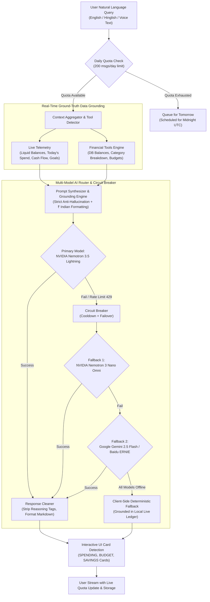
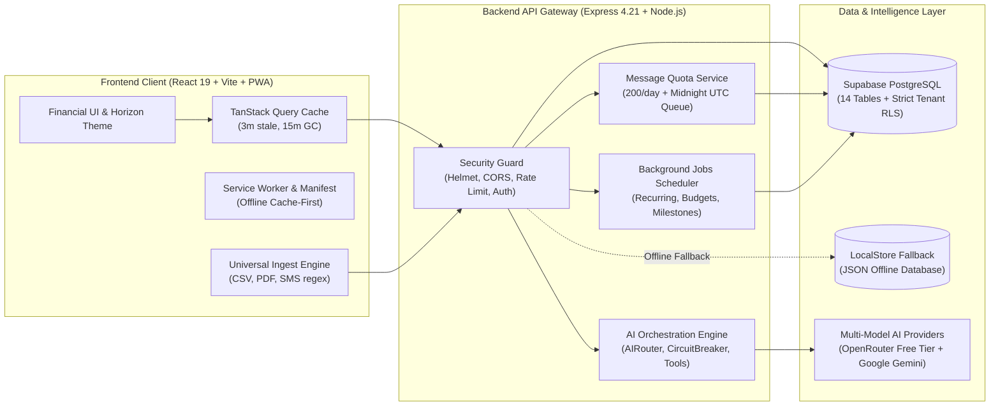

# SPENDX — Next-Generation AI Personal Finance Operating System

[](https://www.typescriptlang.org/)
[](https://react.dev/)
[](https://vitejs.dev/)
[](https://tailwindcss.com/)
[](https://expressjs.com/)
[](https://nodejs.org/)
[-success.svg)](https://vitest.dev/)
[](https://web.dev/progressive-web-apps/)
[](LICENSE)

---

## 1. Project Overview & Vision

**SPENDX** (*Your Money. Your Intelligence.*) is a production-grade, privacy-first personal wealth operating system. Engineered as an enterprise monorepo with a decoupled reactive **React 19 / Vite** single-page application and a hardened **Express / TypeScript** API microservice, SPENDX transforms fragmented personal financial records into real-time, actionable intelligence.

Beyond standard transaction tracking, SPENDX features an **autonomous multi-model AI financial advisory engine**, universal statement ingestion (CSV, Excel, PDF statements, and Indian Bank SMS), automated budget pacing, milestone-driven savings vaults, recurring charge anomaly detection, and full offline-first Progressive Web App (PWA) capabilities.

---

## 2. Deep Dive: How AI is Engineered & Utilized in SPENDX

AI in SPENDX is not a simple wrapper around an LLM. It is an **enterprise multi-tiered orchestration engine** designed for high financial precision, zero hallucination, automatic failover, real-time live data grounding, and bilingual fluency (English & Hinglish).



### Core Pillars of the AI System:

### A. Live Real-Time Data Grounding (Zero Hallucination)
- **Live Account Balances**: AI looks at all connected bank accounts, savings accounts, credit cards, and cash wallets to cite exact current balances.
- **Aaj Ka Kharcha (Today's Pulse)**: Tracks transactions made *today* vs *this month* to answer questions like *"aaj kitna kharch hua?"* with exact numbers.
- **Dynamic Ledger Synthesis**: Aggregates total monthly income, expenses, net cash flow, and savings rate.
- **Category Outflow Tracking**: Pinpoints the user's highest spending category (e.g., Food & Dining, Travel, Rent) and calculates potential monthly savings by trimming discretionary spending.
- **Budget Utilization & Pacing**: Understands which category budgets are healthy, approaching limits (>80%), or exceeded (>100%).
- **Savings Goals Progress**: Analyzes emergency funds and milestone targets with current balance, target dates, and completion percentages.

### B. Multi-Model Failover Orchestration (`AIRouter`)
To ensure 99.99% availability without vendor lock-in or quota halts, the backend employs dynamic multi-model routing across verified models:
1. **Primary Model**: `nvidia/nemotron-3.5-lightning:free` (High-speed, instruction-tuned)
2. **Fallback Tier 1**: `nvidia/nemotron-3-nano-omni-30b-a3b-reasoning:free`
3. **Fallback Tier 2**: `nvidia/nemotron-3-ultra-550b-a55b:free`
4. **Fallback Tier 3**: `baidu/ernie-5.5-flash-preview:free`
5. **Fallback Tier 4**: `recursive/flint-v1.0:free`
6. **Enterprise Tier**: `gemini-2.5-flash` via official Google GenAI SDK

If an upstream provider returns HTTP 429 (rate-limit) or 503 (overload), the request transparently fails over to the next eligible model within milliseconds.

### C. Circuit Breaker & Health Cooldowns (`AICircuitBreaker`)
- Models track failure states: `CLOSED` (Healthy), `OPEN` (Tripped/Cooldown), and `HALF_OPEN` (Testing).
- If a model encounters 2 consecutive upstream failures, its circuit trips to `OPEN`, placing it on cooldown (45s to 300s based on error type) to avoid stalling subsequent user requests.

### D. Bilingual Natural Language Understanding (English & Hinglish)
The AI system prompt is fine-tuned to converse naturally in both **English and conversational Hinglish**:
- *"Mera total balance kitna hai?"* $\rightarrow$ Analyzes all accounts and replies with exact live liquid balance.
- *"Aaj kitna kharcha hua?"* $\rightarrow$ Summarizes today's debits and categorized purchases.
- *"Kahan paise jyada kharch ho rahe hain?"* $\rightarrow$ Identifies top outflow categories and suggests actionable caps.
- *"Bachat kaise badhayein?"* $\rightarrow$ Applies the 50/30/20 rule, pay-yourself-first strategy, and subscription audits tailored to the user's specific ledger.

### E. Daily Quota Guard & Next-Day Scheduling (`AIMessageQuotaService`)
- Enforces an allotment of **200 messages per user per day**.
- Dynamic reset calculation at midnight (00:00 UTC).
- **Next-Day Scheduling Queue**: When quota is reached, users can schedule inquiries for tomorrow. A dedicated modal allows users to review, edit, or cancel queued inquiries.

### F. Single Unified "AI Coach" Experience
- Merged the previously separate "AI Assistant" and "Insights" navigation items into a single, cohesive **AI Coach** workspace.
- Live automated financial insights (spending alerts, milestone celebrations, budget pacing tips) are embedded directly within the AI Coach welcome screen with one-click conversational prompts.

---

## 3. Core Functional Modules

| Module | Route | Architectural Capabilities |
|---|---|---|
| **Executive Dashboard** | `/dashboard` | Net worth aggregate, income vs. expense cash flow, active budget meters, savings milestones, upcoming recurring bills, and AI pulse widget. |
| **Financial Ledger** | `/transactions` | Multi-account transaction table, merchant search, category filters, receipt attachments, and universal statement import modal. |
| **Universal Ingestion Engine** | Modal (`/transactions`) | Client-side statement parser supporting **RFC 4180 CSV**, **Excel (.xlsx)**, **PDF text extraction**, and **Indian Bank SMS** regex parser with 24-hour duplicate transaction prevention. |
| **Account Vault** | `/accounts` | Bank accounts, credit cards, investment portfolios, cash wallets, inter-account fund transfers, and balance reconciliation. |
| **Budget Discipline** | `/budgets` | Category limits, real-time consumption progress bars, threshold overrun warnings (>80%, 100%), and automatic month-end carryover analysis. |
| **Savings Milestones** | `/savings` | Goal setting (Emergency Fund, Gadgets, Vacation), contribution deposits, and automated milestone celebration alerts (50%, 100%). |
| **Recurring Commitments** | `/recurring` | Subscription schedule tracking (Netflix, Spotify, Rent, Utilities), frequency detection (Monthly, Weekly, Yearly), and payment status indicators. |
| **Financial Telemetry & Analytics** | `/analytics` | Interactive Recharts visualizations: Spending Trends, Category Outflow Heatmaps, Income Breakdown, and Period-over-Period comparisons. |
| **Tax & Financial Reports** | `/reports` | Monthly financial balance sheets, CSV exports, Section 80D/80E/80GG Indian tax deduction tags, and browser printable statement templates. |
| **AI Coach & Advisory** | `/ai-assistant` | Grounded multi-model financial coach, live context aggregation, interactive answer cards (Spending, Budget, Savings), and daily quota manager. |
| **Profile & Settings** | `/settings` | System preferences, light/dark theme toggle, currency configuration, PWA installation manager, and account lifecycle controls. |

---

## 4. Complete Technology Stack

### Frontend Monorepo (`/frontend`)
- **Core Framework**: React 19 + TypeScript 5.7 + Vite 6
- **Styling & Design System**: Tailwind CSS v4, Phosphor Icons, Lucide React, Motion for React (Framer Motion)
- **State Management**: TanStack React Query v5 (stale-while-revalidate caching) + Zustand v5
- **Forms & Schema Validation**: React Hook Form + Zod v3
- **Data Visualization**: Recharts (smooth animations, responsive SVGs)
- **Notifications & Dialogs**: Sonner rich toast notifications, custom glassmorphism accessible modals (`ConfirmModal`)
- **PWA Infrastructure**: Service Worker (`sw.js`) with Cache-First static caching, `manifest.webmanifest`, standalone launch support, and iOS Add-to-Home-Screen guide
- **Parsers**: PapaParse (CSV), PDF.js (`pdfjs-dist`), custom Indian Bank SMS regex parser
- **Testing**: Vitest + React Testing Library + JSDOM (14 test suites, **89 unit tests passed 100%**)

### Backend Microservice (`/backend`)
- **Runtime**: Node.js LTS (v20+ / v26) + Express 4.21 + TypeScript 5.7
- **Database & Auth**: Supabase PostgreSQL with strict **Row Level Security (RLS)**
- **AI Core**: Multi-Model OpenRouter failover client + Google Gemini SDK (`@google/genai`)
- **Security & Hardening**: Helmet (HSTS, CSP, Frameguard), CORS, express-rate-limit, crypto-salted password hashing, XSS sanitization
- **Logging & Monitoring**: Pino structured JSON logger (`pino-http`), Sentry (`@sentry/node`) error monitoring
- **Background Automation**: In-memory cron scheduler for recurring payment checks, budget consumption warnings, and milestone alerts
- **Testing**: Vitest + Supertest (7 test suites, **76 unit tests passed 100%**)

---

## 5. System Architecture



---

## 6. Database Schema & Migrations

All SQL migrations reside in `backend/src/db/migrations/` and run sequentially:

1. **`001_initial_schema.sql`**: Core schema establishing 14 tables: `profiles`, `accounts`, `categories`, `transactions`, `budgets`, `savings_goals`, `savings_contributions`, `recurring_payments`, `financial_insights`, `capture_events`, `notifications`, `chat_sessions`, `chat_messages`, `reports`.
2. **`002_row_level_security.sql`**: Enables strict RLS on all tables ensuring multi-tenant isolation (`auth.uid() = user_id`).
3. **`003_audit_triggers.sql`**: Automated `updated_at` timestamps, unique reference constraints for duplicate prevention, and automatic default profile seeding on signup.
4. **`004_hybrid_alignment.sql`**: Notification preferences, composite query indexes (`transactions(user_id, date DESC)`), and recurring payments view alias.
5. **`005_ai_message_quota_queue.sql`**: Tables `ai_message_usage` (daily counters) and `ai_message_queue` (scheduled next-day queries) with RLS policies.

---

## 7. Complete API Reference

### AI Assistant & Financial Coach
| Method | Endpoint | Description |
|---|---|---|
| `POST` | `/api/v1/ai/coach` | Natural language coach query (grounded with real-time financial context) |
| `GET` | `/api/v1/ai/status` | AI engine telemetry, circuit breaker states, and active primary model |
| `GET` | `/api/v1/ai/models` | List prioritized eligible models with capability matrix |
| `GET` | `/api/v1/ai/quota` | Get user's daily 200 message quota and remaining count |
| `POST` | `/api/v1/ai/queue` | Schedule an inquiry for tomorrow (when daily limit is reached) |
| `GET` | `/api/v1/ai/queue` | Retrieve active queued messages |
| `PATCH` | `/api/v1/ai/queue/:id` | Update query text of a scheduled inquiry |
| `DELETE` | `/api/v1/ai/queue/:id` | Cancel a scheduled inquiry |
| `GET` | `/api/v1/ai/sessions` | Retrieve persistent chat conversation sessions |
| `GET` | `/api/v1/ai/sessions/:id/messages` | Get message history for a specific conversation session |
| `DELETE` | `/api/v1/ai/sessions/:id` | Delete conversation session |
| `GET` | `/api/v1/ai/insights` | Retrieve evidence-based financial insights and recommendations |

### Transactions & Universal Ingestion
| Method | Endpoint | Description |
|---|---|---|
| `GET` | `/api/v1/transactions` | Paginated transaction ledger with filters (type, category, date, search) |
| `POST` | `/api/v1/transactions` | Create transaction (validates amount, account, and 24h duplicates) |
| `POST` | `/api/v1/transactions/batch` | Bulk transaction upload |
| `GET` | `/api/v1/transactions/:id` | Retrieve single transaction details |
| `PATCH` | `/api/v1/transactions/:id` | Update transaction metadata |
| `DELETE` | `/api/v1/transactions/:id` | Remove transaction from ledger |

### Accounts, Budgets, Savings & Recurring
| Method | Endpoint | Description |
|---|---|---|
| `GET` | `/api/v1/accounts` | Retrieve user accounts and balances |
| `POST` | `/api/v1/accounts` | Create new account (Bank, Cash, Savings, Card) |
| `GET` | `/api/v1/budgets` | Monthly category spending caps and utilization metrics |
| `POST` | `/api/v1/budgets` | Create category budget cap |
| `GET` | `/api/v1/savings` | Savings targets and accumulated balances |
| `POST` | `/api/v1/savings/:id/contributions` | Record contribution towards savings goal |
| `GET` | `/api/v1/recurring` | List scheduled recurring payments and subscriptions |
| `POST` | `/api/v1/recurring` | Register new recurring schedule |

### Authentication & System Health
| Method | Endpoint | Description |
|---|---|---|
| `POST` | `/api/v1/auth/register` | Register new account with crypto-salted password |
| `POST` | `/api/v1/auth/login` | Authenticate user and issue JWT session token |
| `GET` | `/api/v1/auth/me` | Fetch authenticated user profile |
| `GET` | `/api/v1/health` | Microservice liveness probe (200 OK) |
| `GET` | `/api/v1/health/ready` | Readiness check (memory, database connectivity, scheduler status) |

---

## 8. Local Development & Installation

### Prerequisites
- **Node.js**: `>= 20.x` (v26 LTS recommended)
- **npm**: `>= 10.x`
- **Git**

### 1. Clone & Install Dependencies
```bash
# Clone the repository
git clone https://github.com/void-dev01/SpendX.git
cd SpendX

# Install backend dependencies
cd backend
npm install

# Install frontend dependencies
cd ../frontend
npm install
```

### 2. Configure Environment Variables
Copy the example configuration files in both packages:

**Backend (`backend/.env` & root `.env`):**
```ini
PORT=5000
NODE_ENV=development
FRONTEND_URL=http://localhost:5173

# Supabase Credentials
SUPABASE_URL=https://your-project-ref.supabase.co
SUPABASE_ANON_KEY=your-supabase-anon-key
SUPABASE_SERVICE_ROLE_KEY=your-supabase-service-role-key

# AI Orchestration (OpenRouter and/or Gemini)
OPENROUTER_API_KEY=your-openrouter-api-key
OPENROUTER_MODEL=nvidia/nemotron-3.5-lightning:free
GEMINI_API_KEY=your-optional-gemini-key
```

**Frontend (`frontend/.env`):**
```ini
VITE_API_BASE_URL=http://localhost:5000/api/v1
VITE_SUPABASE_URL=https://your-project-ref.supabase.co
VITE_SUPABASE_ANON_KEY=your-supabase-anon-key
```

### 3. Run Development Servers
```bash
# Terminal 1 — Start Backend Server (Port 5000)
cd backend
npm run dev

# Terminal 2 — Start Frontend Client (Port 5173)
cd frontend
npm run dev
```

Visit `http://localhost:5173` to open the application.

---

## 9. Comprehensive Verification & Test Suite

SPENDX maintains **100% test pass rate** across all functional modules:

```bash
# Run backend test suite (76 tests)
cd backend
npm test

# Run frontend test suite (89 tests)
cd frontend
npm test

# Run type checking across entire monorepo
cd backend && npm run typecheck
cd ../frontend && npm run typecheck
```

### Test Results Summary:
- **Backend Tests**: 7 test suites, **76 passed (100%)**
  - Security & Authentication tests
  - AI Orchestration & Circuit Breaker tests
  - Automated background scheduler jobs
  - Storage & Document signed URL tests
  - Extended REST APIs tests
- **Frontend Tests**: 14 test suites, **89 passed (100%)**
  - AI Assistant & Coach test suite
  - Dashboard & Telemetry tests
  - Universal Statement Ingestion (CSV, SMS regex)
  - Accounts, Budgets & Savings tests
  - Responsive Layout & Navigation tests
- **TypeScript Typecheck**: **0 errors** (`tsc --noEmit`)

---

## 10. Progressive Web App (PWA) Features

SPENDX is built with full standalone PWA capabilities:
- **Offline Reliability**: Service Worker caches app shell and static assets for sub-50ms instant cold reloads.
- **Install Anywhere**: Standalone install options available directly in the top navbar, desktop sidebar, profile menu, and settings.
- **iOS Safari Support**: Dedicated iOS install modal guiding users to *"Add to Home Screen"* with visual cues.
- **Mobile Responsive Navigation**: Dynamic bottom navigation bar optimized for handheld touch devices (<768px).

---

## 11. Security & Compliance

- **Cryptographic Tenant Isolation**: Enforced via PostgreSQL Row Level Security (RLS). Users can never access or modify another tenant's records.
- **Zero Raw Credential Storage**: SPENDX never stores banking passwords, debit card PINs, or net banking credentials.
- **Input Sanitization**: Incoming request payloads pass through strict Zod validators, HTML entity sanitizers, and SQL injection pattern detectors.
- **Rate Limiting & DoS Protection**: Sensitive endpoints (auth, transactions, AI queries) are guarded by express-rate-limit.
- **Safe Error Boundaries**: React error boundaries and production error mappers ensure technical stack traces are never leaked to end users.

---

## 12. License
This project is open-source and licensed under the [MIT License](LICENSE).
