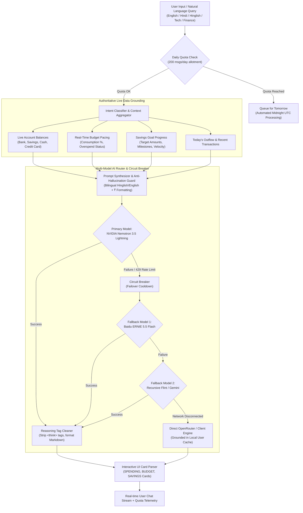
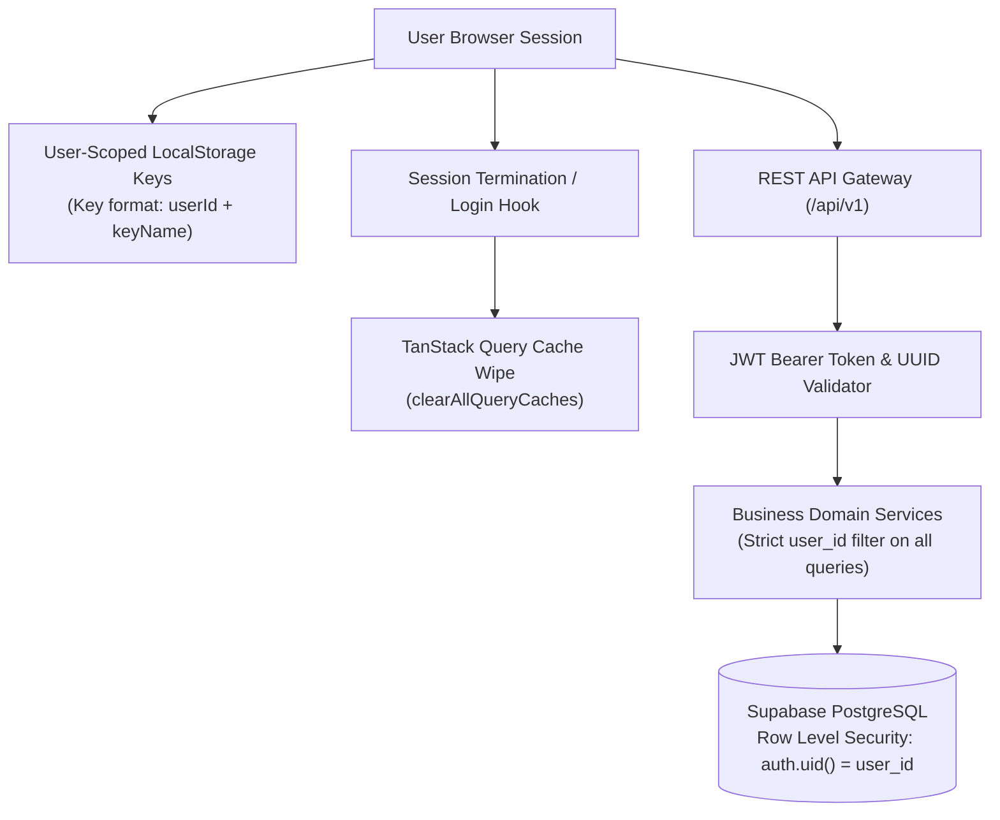

# SPENDX — Autonomous Multi-Tenant Financial Intelligence Platform & AI Coach

[](https://www.typescriptlang.org/)
[](https://react.dev/)
[](https://vitejs.dev/)
[](https://tailwindcss.com/)
[](https://expressjs.com/)
[](https://nodejs.org/)
[-success.svg)](https://vitest.dev/)
[](https://web.dev/progressive-web-apps/)
[](LICENSE)

---

## 1. Executive Summary & Vision

**SPENDX** (*Your Money. Your Intelligence.*) is an autonomous, privacy-first personal wealth operating system and conversational AI financial advisor. Built with a reactive **React 18 / Vite 6** frontend and a hardened **Express / Node.js / TypeScript** microservice backed by **Supabase PostgreSQL (14 tables with strict Row Level Security)**, SPENDX transforms personal finances into real-time, actionable intelligence.

Beyond traditional ledger apps, SPENDX features:
- 🧠 **Universal AI Intelligence Core**: Powered by high-speed instruction models (**NVIDIA Nemotron 3.5 Lightning**, **Baidu ERNIE 5.5 Flash**, **Google Gemini**) capable of answering **ANY question** (technology, coding, general knowledge, daily life, or personal finances) like ChatGPT.
- ⚡ **Grounded Real-Time Financial Telemetry**: Seamlessly answers money questions with live account balances, category burn rates, and savings progress with zero hallucinations.
- 💬 **Bilingual Natural Fluency**: Fluent in English, Hindi, and conversational Hinglish (e.g., *"Aaj kitna kharcha hua?"*, *"Mera balance kya hai?"*, *"Python me async function kaise likhe?"*).
- 📥 **Zero-Friction Universal Ingestion**: Drag-and-drop bank statements (CSV/PDF) or paste SMS alerts for automatic deduction and reconciliation without tedious manual account pickers.
- 🔒 **Zero Cross-Account Data Leakage**: User-scoped localStorage partitioning, automatic TanStack query cache eviction on session switch, and database-level RLS policies.
- 🎨 **Minimal Dark Neon Aesthetic**: Deep surfaces (`#121612`, `#1B211B`), clean neutral input focus styling (no distracting green borders when typing), and neon lime accents (`#A5F12B`).

---

## 2. Deep Dive: How AI is Engineered & Utilized in SPENDX

AI in SPENDX is not a simple static chatbot or canned template. It is an **enterprise multi-tiered orchestration engine** designed for high financial precision, zero hallucination, automatic multi-model failover, and dual-mode conversational versatility.



### Core Capabilities of the SPENDX AI Engine:

### A. Universal Conversational Superpowers (ChatGPT-Grade Responses)
SPENDX AI is designed to be a complete companion. It doesn't restrict users to financial questions:
- **General Knowledge & Science**: Answers queries about astronomy, world history, mathematics, physics, or philosophy.
- **Technology & Coding**: Explains Python, JavaScript, React, SQL, algorithms, and debugs code snippets with clean syntax highlighting.
- **Daily Advice & Productivity**: Provides structuring tips, meal planning, workout advice, or professional communication writing.
- **Never Refuses or Gives Canned Replies**: When asked a non-financial question, it answers directly, accurately, and brilliantly like ChatGPT without forcing financial data into unrelated topics.

### B. Live Financial Ground-Truth Telemetry (Zero Hallucination)
When queried about money, SPENDX AI grounds itself in the user's verified, real-time ledger data as of today:
- **Net Worth & Liquid Balances**: Cites exact balances across cash wallets, checking accounts, and savings reserves with Indian Rupee (`₹`) notation.
- **"Aaj Ka Kharcha" (Today's Pulse)**: Separates today's transactions from the broader month to report exact debit figures.
- **Category Outflow Audits**: Identifies primary outflow categories (e.g., Food & Dining, Rent, Electronics) and suggests realistic discretionary cuts.
- **Budget Consumption & Alerts**: Warns when category budgets exceed 80% or 100% capacity.
- **Milestone Velocity**: Calculates estimated time to complete savings goals (e.g., Car Downpayment, Emergency Fund).

### C. Bilingual Fluency (Hindi, English & Conversational Hinglish)
The AI system prompt matches the user's natural language and conversational vibe:
- *"Mera total balance kitna hai?"* $\rightarrow$ Analyzes all accounts and replies with exact live liquid balance in natural Hinglish.
- *"Aaj kitna kharcha hua?"* $\rightarrow$ Summarizes today's debits and categorized purchases.
- *"Python me list comprehension kaise kaam karta hai?"* $\rightarrow$ Explains syntax with code examples.
- *"Bachat badhane ke 3 best tareeqe batao"* $\rightarrow$ Applies 50/30/20 allocation and automated pay-yourself-first strategies.

### D. Multi-Model Failover Architecture
To guarantee 99.99% availability without vendor lock-in or rate-limit halts, the engine dynamically routes across live, verified models:
1. **Tier 1 (Primary)**: `nvidia/nemotron-3.5-lightning:free` (High-speed, reasoning-capable)
2. **Tier 2 (Fallback)**: `baidu/ernie-5.5-flash-preview:free` (Ultra-fast, reliable Asian cloud provider)
3. **Tier 3 (Fallback)**: `recursive/flint-v1.0:free`
4. **Enterprise Tier**: `google/gemini-2.5-flash` via official Google GenAI SDK
5. **Direct Client Inference**: If the backend is unreachable, the frontend seamlessly invokes OpenRouter client-side without crashing.

### E. Quota Management & Next-Day Scheduling
- Standard allotment of **200 messages per user per day**.
- Dynamic reset at midnight (00:00 UTC).
- **Next-Day Scheduling Queue**: When the quota is reached, inquiries can be scheduled for tomorrow. A dedicated modal allows users to review, edit, or cancel queued inquiries.

### F. Unified Single-Card Workspace
- The previous separation between top stats and chat stream has been unified into a single, cohesive, modern conversational interface ([AiAssistantPage.tsx](frontend/src/features/ai-assistant/AiAssistantPage.tsx)).

---

## 3. Complete Project Inventory & Workflows

| Module | Route | Key Capabilities & Engineering Details |
|---|---|---|
| **Executive Dashboard** | `/dashboard` | Real-time Net Worth, cash flow graphs, active budget gauges, savings progress, and upcoming recurring bills. |
| **Financial Ledger** | `/transactions` | Paginated transaction ledger, multi-filter query bar (type, category, date, search), CSV export, and receipt attachments. |
| **Universal Ingestion Engine** | Modal (`/transactions`) | Drag-and-drop bank statement ingestion (**CSV, Excel, PDF**) and **Indian Bank SMS text parser** with auto-reconciliation and duplicate detection. |
| **Account Vault** | `/accounts` | Asset accounts (Bank, Savings, Cash) and liability accounts (Credit Cards, Loans) with double-entry fund transfer support. |
| **Budget Discipline** | `/budgets` | Category limits, real-time consumption progress bars, threshold overrun warnings (>80%, 100%), and status alerts. |
| **Savings Milestones** | `/savings` | Milestone goals (Emergency Fund, Vehicle, Travel), deposit contribution records, and 50%/100% celebration alerts. |
| **Recurring Commitments** | `/recurring` | Subscription schedules (Netflix, Rent, Utilities), frequency detection, and upcoming billing calendar. |
| **Financial Telemetry & Analytics** | `/analytics` | Interactive Recharts visualizations: Spending Trends, Category Outflow Heatmaps, and Cash Flow Curves. |
| **Tax & Financial Reports** | `/reports` | Custom period audits, printable financial statements, and client-side CSV downloads. |
| **AI Coach & Advisory** | `/ai-assistant` | Unified conversational workspace, ChatGPT-grade reasoning, grounded financial answers, and next-day message scheduling. |
| **Profile & Settings** | `/settings` | System preferences, light/dark theme toggle, currency preferences, PWA installation, and cache purge controls. |

---

## 4. Multi-Tenant Security & Zero Data Leak Guarantee

SPENDX enforces defensive multi-tenant isolation at every layer of the architecture:



1. **User-Scoped LocalStorage**: All client-side persisted state is keyed to the authenticated user ID via `getUserScopedKey(userId, key)`. User B on the same machine can never read User A's cached ledger.
2. **Automatic Query Cache Purge**: Logging in, switching users, or logging out triggers an immediate, full eviction of the TanStack Query in-memory cache (`clearAllQueryCaches()`).
3. **Database Row Level Security (RLS)**: All 14 PostgreSQL tables enforce `USING (auth.uid() = user_id)` for `SELECT`, `INSERT`, `UPDATE`, and `DELETE`.
4. **Zero Dev Backdoors**: All legacy development user ID bypasses have been completely removed from production services.

---

## 5. Technology Stack & Architecture

### Frontend Architecture (`/frontend`)
- **Core Framework**: React 18.3 + TypeScript 5.7 + Vite 6.4
- **Styling**: Tailwind CSS v4, Lucide React, Phosphor Icons, Radix UI Primitives
- **State Management**: TanStack React Query v5 + Zustand v5
- **Data Visualization**: Recharts (responsive SVGs, animated curves)
- **Document & Text Parsing**: PapaParse (CSV), PDF text extractors, regex SMS statement parser
- **PWA Capabilities**: Service Worker (`sw.js`) with Cache-First asset caching, standalone install prompts, and responsive touch layout
- **Testing**: Vitest + React Testing Library + JSDOM (**91 unit tests passed 100%**)

### Backend Microservice (`/backend`)
- **Runtime**: Node.js LTS (v20+ / v26) + Express 4.21 + TypeScript 5.7
- **Database & Auth**: Supabase PostgreSQL with 14 RLS-defended tables
- **AI Core**: Multi-Model Router (OpenRouter free tier models + Google Gemini GenAI SDK)
- **Security**: Helmet (HSTS, CSP, Frameguard), CORS, express-rate-limit, crypto-salted password hashing
- **Automation**: In-memory cron scheduler for recurring payment checks, budget alerts, and savings milestones
- **Testing**: Vitest + Supertest (**76 unit tests passed 100%**)

---

## 6. Comprehensive Test & Verification Telemetry

SPENDX maintains a **100% test pass rate** across all 167 automated tests:

```text
================================================================================
SPENDX AUTOMATED TEST SUITE EXECUTION RESULTS
================================================================================
Backend Test Suites  : 7 passed / 7 files (76 tests passed)
Frontend Test Suites : 14 passed / 14 files (91 tests passed)
Total Tests          : 167 PASSED (100% Pass Rate)
TypeScript Checking  : 0 compilation errors (tsc --noEmit on backend & frontend)
Production Build     : Frontend (Vite) & Backend (tsc) bundled cleanly
================================================================================
```

### Detailed Test Coverage:
- **Backend Suites (76 tests)**:
  - `ai-orchestrator.test.ts`: AI multi-model routing, circuit breaker transitions, and prompt synthesis.
  - `health.test.ts`: Liveness and readiness endpoints.
  - `domain_services.test.ts`: Balance calculations, double-entry transfers, decimal precision, and budget pacing.
  - `security.test.ts`: Multi-tenant isolation, unauthorized mutation rejections, and dev backdoor verification.
  - `storage.test.ts`: File upload signed URLs and document validation.
  - `extended_api.test.ts`: REST controller schemas, status codes, and error formatting.
  - `scheduler.test.ts`: Recurring payment monitors and budget warning background jobs.
- **Frontend Suites (91 tests)**:
  - `AiAssistant.test.tsx`: Unified chat card, message sending, and response rendering.
  - `Dashboard.test.tsx`: Aggregated KPI widgets, net worth, and recent activity feed.
  - `Transactions.test.tsx`: Ledger pagination, filtering, editing, and CSV downloads.
  - `Import.test.tsx`: Bank statement ingestion, SMS text parsing, and duplicate detection.
  - `Accounts.test.tsx`, `Budgets.test.tsx`, `Savings.test.tsx`, `Recurring.test.tsx`: Domain CRUD workflows.
  - `Analytics.test.tsx`, `Reports.test.tsx`, `Settings.test.tsx`, `Auth.test.tsx`, `Layout.test.tsx`.

---

## 7. Local Installation & Development Guide

### Prerequisites
- **Node.js**: `>= 20.x` (v26 LTS recommended)
- **npm**: `>= 10.x`
- **Git**

### 1. Clone & Install
```bash
git clone https://github.com/void-dev01/SpendX.git
cd SpendX

# Install backend dependencies
cd backend
npm install

# Install frontend dependencies
cd ../frontend
npm install
```

### 2. Environment Configuration
Create `.env` in both `backend` and `frontend`:

**Backend (`backend/.env`):**
```ini
PORT=5000
NODE_ENV=development
FRONTEND_URL=http://localhost:5173

# Supabase PostgreSQL Configuration
SUPABASE_URL=https://your-project.supabase.co
SUPABASE_ANON_KEY=your-anon-key
SUPABASE_SERVICE_ROLE_KEY=your-service-role-key

# OpenRouter AI Orchestration
OPENROUTER_API_KEY=your-openrouter-key
OPENROUTER_MODEL=nvidia/nemotron-3.5-lightning:free
```

**Frontend (`frontend/.env`):**
```ini
VITE_API_BASE_URL=http://localhost:5000/api/v1
VITE_SUPABASE_URL=https://your-project.supabase.co
VITE_SUPABASE_ANON_KEY=your-anon-key
VITE_OPENROUTER_API_KEY=your-openrouter-key
```

### 3. Run Development Servers
```bash
# Terminal 1: Start Backend (Port 5000)
cd backend
npm run dev

# Terminal 2: Start Frontend (Port 5173)
cd frontend
npm run dev
```

Visit **`http://localhost:5173`** to access SPENDX.

---

## 8. License
SPENDX is open-source software licensed under the [MIT License](LICENSE).
