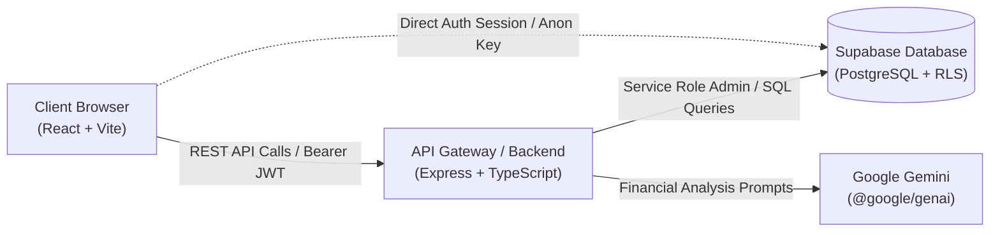
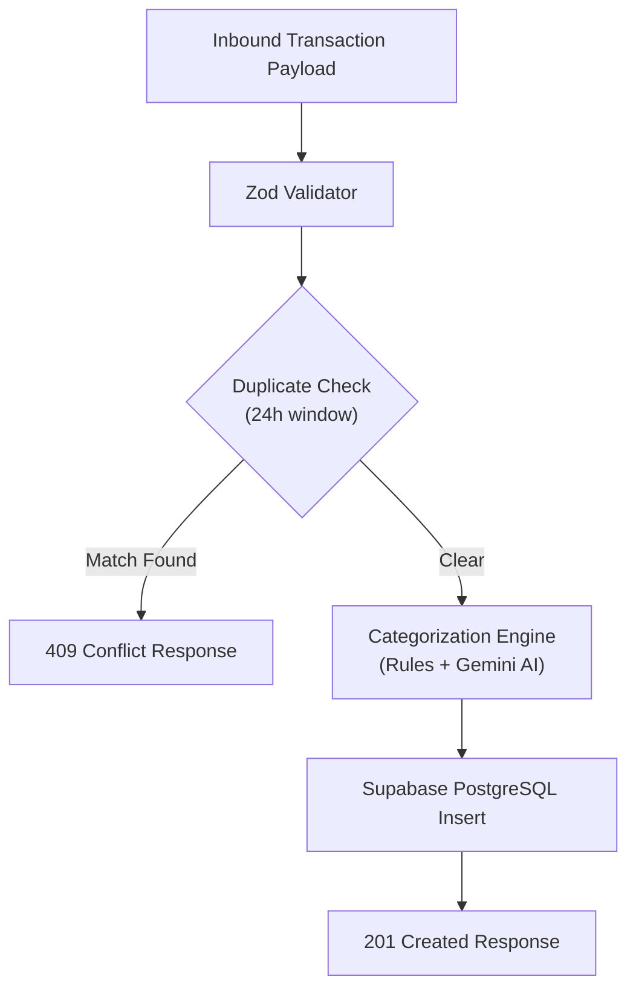

# SPENDX — AI-Powered Personal Finance Management Platform

[](https://www.typescriptlang.org/)
[](https://react.dev/)
[](https://vitejs.dev/)
[](https://tailwindcss.com/)
[](https://expressjs.com/)
[](https://nodejs.org/)
[](LICENSE)

---

## 1. Project Title and Overview
**SPENDX** is an enterprise-grade, privacy-centric, AI-powered personal finance management ecosystem. Engineered as two decoupled, independently deployable systems—a reactive Vite/React client and a hardened Express/Node API microservice—SPENDX delivers continuous financial awareness, automatic categorization, predictive cash flow analytics, and proactive conversational coaching.

---

## 2. SPENDX Product Introduction
Managing wealth and daily expenditures in modern economies has become fragmented across bank accounts, credit cards, investment portfolios, and digital wallets. SPENDX consolidates financial footprints into a unified platform. Powered by Google Gemini AI and Supabase PostgreSQL with strict Row-Level Security (RLS), SPENDX bridges the gap between passive bookkeeping and active financial growth.

---

## 3. Problem Statement
Individuals face persistent hurdles in managing personal solvency:
- **Scattered Data**: Transactions reside across disparate financial institutions without real-time consolidation.
- **Manual Overhead**: Manual bookkeeping requires arduous receipt tracking and manual categorization.
- **Reactive Insights**: Traditional banking applications report historical spending without proactive, actionable warnings.
- **Privacy Compromise**: Many finance apps monetize personal financial data or mix client-side analytics with third-party tracking.

---

## 4. Product Vision
To provide every user with an autonomous, mathematically rigorous, and intelligent financial co-pilot that:
- Captures income and expenditure in real-time.
- Prevents accidental duplicates and overdrafts.
- Categorizes transactions with semantic intelligence.
- Recommends proactive adjustments through an AI financial coach.
- Safeguards customer data with zero-trust cryptographic isolation.

---

## 5. Core Features
- **Centralized Financial Ledger**: Real-time record of all monetary movements with account associations.
- **Duplicate Transaction Prevention**: Algorithmic detection of identical transactions within 24-hour windows.
- **Dynamic Category Budgeting**: Month-over-month spending caps with progress tracking and variance alerting.
- **Savings Goals**: Milestone tracking for emergency reserves, debt retirement, and capital investments.
- **Fintech Design System**: Premium dark/light theme foundation adhering to modern financial UI standards.
- **Enterprise Rate Limiting**: Global and per-endpoint rate limiters protecting against denial of service.

---

## 6. Advanced AI Features
- **Semantic Transaction Categorization**: Real-time merchant classification and smart tagging via Gemini.
- **Conversational AI Coach**: Direct dialogue on debt repayment strategies, tax-advantaged accounts, and budget trims.
- **Automated Financial Insights**: Background generation of actionable alerts (warnings, tips, milestones, anomalies).
- **Spending Velocity Forecasting**: Predictive projection of month-end balances based on historical burn rates.

---

## 7. Technology Stack
| Layer | Technologies |
|---|---|
| **Frontend Core** | React 19, Vite 6, TypeScript 5.7 |
| **Styling & UI** | Tailwind CSS v4, Radix UI Primitives, Lucide React, Motion for React |
| **Routing & State** | React Router v7, Zustand, TanStack Query v5 |
| **Forms & Validation** | React Hook Form, Zod, Hookform Resolvers |
| **Charts & Alerts** | Recharts, Sonner |
| **Backend Core** | Node.js (v26 LTS ready), Express 4.21, TypeScript 5.7 |
| **Security & Logging** | Helmet, CORS, express-rate-limit, Pino, pino-http |
| **Database & Auth** | Supabase PostgreSQL, Supabase JS SDK, PostgreSQL RLS |
| **AI Integration** | Google Gemini API via official `@google/genai` SDK |
| **Testing** | Vitest, Supertest, Testing Library |

---

## 8. System Architecture
SPENDX adopts a clean, service-oriented architecture:


---

## 9. Frontend Architecture
- **Feature-Driven Modular Structure**: Business domains (`auth`, `dashboard`, `transactions`, `budgets`, `analytics`, `ai-coach`, `savings`, `settings`) encapsulate their views and state.
- **Custom UI Components**: Built on Radix primitives and Tailwind CSS v4 classes via `class-variance-authority` and `clsx`/`tailwind-merge`.
- **Global Theme Engine**: Zero-flash theme toggling supporting the SPENDX brand palette (`#EAF5F0` light, `#101A19` dark).
- **Asynchronous Data Layer**: TanStack Query handles server state caching, background invalidation, and deduplication.

---

## 10. Backend Architecture
- **Layered Separation of Concerns**: Strict delineation between Controllers, Services, Middleware, and Validators.
- **Validation-First Ingress**: Every payload is vetted through strict Zod schemas before hitting business logic.
- **Centralized Error Boundary**: Operational errors produce uniform JSON envelopes (`ApiResponse<T>`).
- **Resilient Fallback Mode**: Gracefully operates in offline/mock mode when external cloud credentials (Supabase/Gemini) are pending.

---

## 11. Database Architecture
Hosted on Supabase PostgreSQL with 12 foundational schemas:
1. `profiles`: Extended user demographic and preference records.
2. `accounts`: Bank, credit card, and investment ledger accounts.
3. `transactions`: Ingested debits, credits, and transfers.
4. `categories`: Global taxonomy and custom user categories.
5. `budgets`: Category allocation caps over calendar periods.
6. `savings_goals`: Target accumulation funds with milestone deadlines.
7. `capture_events`: Inbound webhooks, receipt scans, and import logs.
8. `recurring_transactions`: Subscriptions and repeating payroll schedules.
9. `financial_insights`: System-generated optimization recommendations.
10. `chat_sessions`: Persistent conversation threads with AI Coach.
11. `chat_messages`: Context history and token metrics.
12. `notification_preferences`: Delivery channels and alert thresholds.

---

## 12. Complete Project Folder Structure
```text
SPENDX/
│
├── frontend/
│   ├── public/
│   ├── src/
│   │   ├── assets/
│   │   ├── components/
│   │   │   ├── common/
│   │   │   │   ├── Header.tsx
│   │   │   │   └── Sidebar.tsx
│   │   │   ├── layout/
│   │   │   │   └── AppLayout.tsx
│   │   │   └── ui/
│   │   │       ├── badge.tsx
│   │   │       ├── button.tsx
│   │   │       └── card.tsx
│   │   ├── features/
│   │   │   ├── ai-coach/
│   │   │   │   └── AiCoachPage.tsx
│   │   │   ├── analytics/
│   │   │   │   └── AnalyticsPage.tsx
│   │   │   ├── auth/
│   │   │   │   └── AuthPage.tsx
│   │   │   ├── budgets/
│   │   │   │   └── BudgetsPage.tsx
│   │   │   ├── dashboard/
│   │   │   │   └── DashboardPage.tsx
│   │   │   ├── savings/
│   │   │   │   └── SavingsPage.tsx
│   │   │   ├── settings/
│   │   │   │   └── SettingsPage.tsx
│   │   │   └── transactions/
│   │   │       └── TransactionsPage.tsx
│   │   ├── hooks/
│   │   ├── lib/
│   │   │   └── utils.ts
│   │   ├── routes/
│   │   │   └── index.tsx
│   │   ├── services/
│   │   │   ├── api.ts
│   │   │   └── supabase.ts
│   │   ├── stores/
│   │   │   ├── authStore.ts
│   │   │   └── themeStore.ts
│   │   ├── test/
│   │   │   ├── App.test.tsx
│   │   │   └── setup.ts
│   │   ├── types/
│   │   │   └── index.ts
│   │   ├── utils/
│   │   ├── App.tsx
│   │   ├── index.css
│   │   ├── main.tsx
│   │   └── vite-env.d.ts
│   ├── .env.example
│   ├── .gitignore
│   ├── .prettierrc
│   ├── eslint.config.js
│   ├── index.html
│   ├── package.json
│   ├── tsconfig.json
│   └── vite.config.ts
│
├── backend/
│   ├── src/
│   │   ├── config/
│   │   │   ├── env.ts
│   │   │   ├── gemini.ts
│   │   │   └── supabase.ts
│   │   ├── controllers/
│   │   │   ├── ai.controller.ts
│   │   │   ├── health.controller.ts
│   │   │   └── transaction.controller.ts
│   │   ├── middleware/
│   │   │   ├── auth.ts
│   │   │   ├── errorHandler.ts
│   │   │   └── rateLimiter.ts
│   │   ├── routes/
│   │   │   ├── ai.routes.ts
│   │   │   ├── health.routes.ts
│   │   │   ├── index.ts
│   │   │   └── transaction.routes.ts
│   │   ├── services/
│   │   │   ├── ai.service.ts
│   │   │   └── transaction.service.ts
│   │   ├── types/
│   │   │   └── index.ts
│   │   ├── utils/
│   │   │   └── logger.ts
│   │   ├── validators/
│   │   │   ├── auth.validator.ts
│   │   │   └── transaction.validator.ts
│   │   ├── app.ts
│   │   └── server.ts
│   ├── tests/
│   │   └── health.test.ts
│   ├── .env.example
│   ├── .gitignore
│   ├── .prettierrc
│   ├── eslint.config.js
│   ├── package.json
│   └── tsconfig.json
│
├── docs/
│   ├── architecture/
│   │   └── system-overview.md
│   ├── database/
│   │   └── schema-design.md
│   ├── api/
│   │   └── api-spec.md
│   └── setup/
│       └── developer-guide.md
│
├── .gitignore
├── README.md
└── TECH_STACK.md
```

---

## 13. Installation Prerequisites
Ensure the host development environment meets the following specifications:
- **Node.js**: `v20.0.0` or higher (verified on Node `v26.13.1`).
- **npm**: `v10.0.0` or higher (verified on npm `11.20.0`).
- **PowerShell / Bash Terminal**.

---

## 14. Frontend Installation Instructions
From the root project directory:
```bash
cd frontend
npm install
```

---

## 15. Backend Installation Instructions
From the root project directory:
```bash
cd backend
npm install
```

---

## 16. Environment Variable Setup
Both applications require local environment configuration files derived from their `.env.example` templates:

### In `frontend/`:
```bash
cp .env.example .env
```
Contains:
```env
VITE_API_BASE_URL=http://localhost:5000/api/v1
VITE_SUPABASE_URL=https://your-project-ref.supabase.co
VITE_SUPABASE_ANON_KEY=your-supabase-anon-key
```

### In `backend/`:
```bash
cp .env.example .env
```
Contains:
```env
PORT=5000
NODE_ENV=development
FRONTEND_URL=http://localhost:5173
SUPABASE_URL=https://your-project-ref.supabase.co
SUPABASE_ANON_KEY=your-supabase-anon-key
SUPABASE_SERVICE_ROLE_KEY=your-supabase-service-role-key
GEMINI_API_KEY=your-google-gemini-api-key
```

---

## 17. How to Run Frontend
```bash
cd frontend
npm run dev
```
Client compiles with hot module replacement (HMR) and opens on `http://localhost:5173`.

---

## 18. How to Run Backend
```bash
cd backend
npm run dev
```
Backend initializes via `tsx` watch mode on `http://localhost:5000`.

---

## 19. How to Run Both Applications
Open two distinct terminal windows:
- **Terminal 1**: `cd SPENDX/backend && npm run dev`
- **Terminal 2**: `cd SPENDX/frontend && npm run dev`

---

## 20. Development Workflow
1. **Branching**: Branch out from `main` using feature prefixes (`feature/`, `bugfix/`).
2. **Local Linting & Typecheck**:
   - `npm run typecheck`
   - `npm run lint`
3. **Automated Testing**:
   - `npm run test`
4. **Production Build Validation**:
   - `npm run build`

---

## 21. API Communication Architecture
Frontend communicates with the backend exclusively via Axios (`frontend/src/services/api.ts`).
- Standard Base Path: `/api/v1`
- Request Headers: Automatically injects `Authorization: Bearer <token>` from local session storage.
- Standard Response Envelopes: All payloads follow `ApiResponse<T>` with `success`, `data`, and `message`.

---

## 22. Authentication Architecture
1. Client logs in or registers via Supabase GoTrue Auth.
2. Supabase issues a cryptographically signed JWT.
3. Client attaches the Bearer token to backend requests.
4. Backend `requireAuth` middleware verifies token integrity against Supabase's authentication service.
5. In development/standalone mode, a demo token bypass enables local UI evaluation without cloud dependency.

---

## 23. AI Integration Architecture
- Driven by `@google/genai` using the `gemini-2.5-flash` model.
- Financial data summaries are formatted into structured prompts.
- Output is enforced through strict typing into `FinancialInsight` objects.
- Built-in heuristic fallback operates when API keys are unpopulated.

---

## 24. Transaction Capture Pipeline


---

## 25. Security Practices
- **Strict Content Security & Hardening**: `helmet` headers enabled across all Express routes.
- **Controlled CORS**: Origin strictly locked to `FRONTEND_URL`.
- **Granular Rate Limiting**: Dedicated rate limits for general API requests (300/15m) and AI operations (30/15m).
- **Zero Client-Side Secret Leakage**: Service role keys and Gemini API keys strictly isolated to server runtime.
- **Postgres Row Level Security**: Database level data partition ensuring users cannot query foreign records.

---

## 26. Testing Strategy
- **Backend Unit & Integration Tests**: Executed via Vitest and Supertest against live Express endpoints.
- **Frontend Component Tests**: Executed via Vitest with `@testing-library/react` and `jsdom` environment.
- **Type Verification**: Both applications run strict TypeScript `tsc --noEmit`.

---

## 27. Git and GitHub Workflow
- Standard `.gitignore` prevents `node_modules`, `.env`, build artifacts (`dist/`), and log files from entering version control.
- Conventional commit messages (`feat:`, `fix:`, `docs:`, `refactor:`, `test:`).
- Main branch protected by CI status checks.

---

## 28. Deployment Strategy
- **Frontend**: Static SPA hosted on Cloudflare Pages, Vercel, or AWS S3 + CloudFront.
- **Backend**: Containerized Node.js service running on AWS ECS, Render, or Google Cloud Run.
- **Database**: Managed Supabase PostgreSQL with automated WAL archiving and point-in-time recovery.

---

## 29. Future Development Roadmap
- [ ] Direct Bank Feed Aggregation (Plaid / Teller integration).
- [ ] OCR Receipt Scanning and line-item extraction.
- [ ] Exportable Monthly Tax and Spending PDF reports.
- [ ] Multi-currency conversion via live exchange rates.
- [ ] Push notifications for real-time budget threshold warnings.

---

## 30. Troubleshooting
| Symptom | Cause | Solution |
|---|---|---|
| `CORS error in browser` | `FRONTEND_URL` mismatch | Set `FRONTEND_URL=http://localhost:5173` in `backend/.env`. |
| `Cannot connect to Supabase` | Empty environment variables | Ensure `SUPABASE_URL` and `SUPABASE_ANON_KEY` are populated. |
| `Gemini AI Coach idle` | Missing `GEMINI_API_KEY` | Provide a valid Google Gemini API key in `backend/.env`. |
| `Port 5000 in use` | Zombie process | Change `PORT` in `backend/.env` or terminate the existing process. |

---

Developed with ❤️ by the SPENDX Engineering Team.
