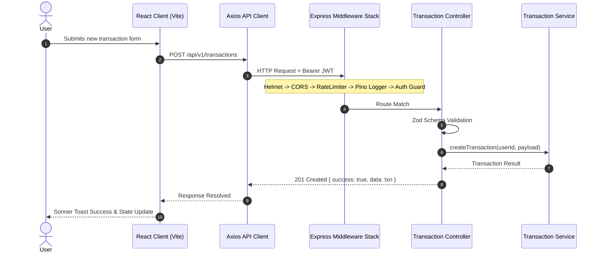
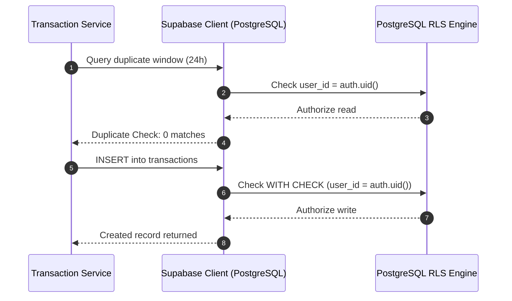
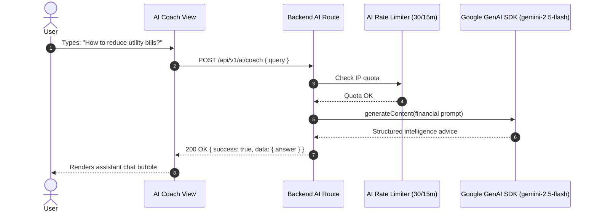
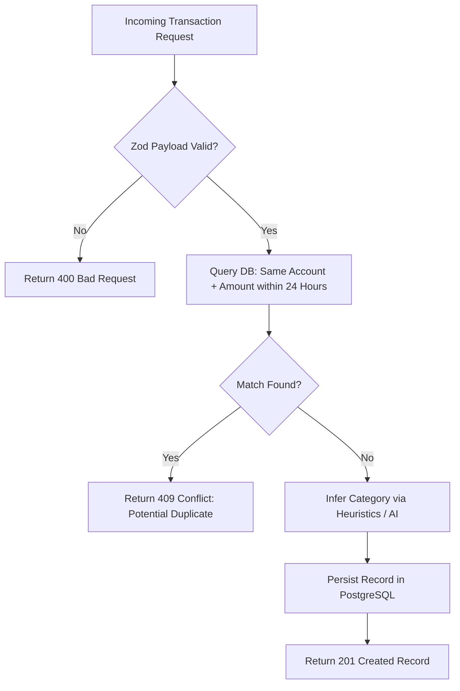

# SPENDX — Deep Technical Stack Documentation

This document provides comprehensive technical documentation for every technology chosen, installed, and planned for the SPENDX ecosystem.

---

## 1. Architectural Philosophy & Decisions

### 1.1 Decoupled Frontend and Backend Architecture
- **Decision**: Frontend and backend are completely separate codebases with independent `package.json`, isolated `node_modules`, and distinct runtime boundaries.
- **Rationale**: Decoupling ensures that client-side bundle size, build optimization, and framework updates remain entirely independent from server-side security dependencies, database drivers, and AI SDKs.
- **Security Guarantee**: Neither Google Gemini API keys nor Supabase service-role administrative keys can leak into client-side JavaScript bundles.

### 1.2 Rejection of Next.js / Server Actions
- **Decision**: Zero Next.js dependencies. Pure React 19 SPA bundled via Vite 6 + standalone Express 4 backend.
- **Rationale**: Full stack meta-frameworks blur boundary lines between client and server code, increasing the risk of accidental secret exposure. A standalone REST API microservice guarantees deterministic request lifecycles, clear CORS enforcement, and uninhibited containerization on Docker, AWS ECS, or Kubernetes.

---

## 2. Frontend Technology Stack (Deep Dive)

### Core Framework & Build Tooling

#### React
- **Exact Installed Version**: `19.3.1`
- **Why Selected**: Industry-standard declarative component model with optimal memory efficiency, concurrent rendering improvements, and vast ecosystem compatibility.
- **Responsibility**: Rendering UI components, client-side routing synchronization, and reactive DOM updates.
- **Where Used**: `frontend/src/**/*.tsx`
- **Interactions**: Consumes state from Zustand stores, queries cached data from TanStack Query, and binds inputs via React Hook Form.
- **Alternatives Considered**: Vue 3 (smaller ecosystem for fintech enterprise components), Svelte 5 (less mature shadcn/radix ecosystem).

#### Vite
- **Exact Installed Version**: `6.4.6`
- **Why Selected**: Extremely fast ES-module based Hot Module Replacement (HMR) and optimized Rollup production builds.
- **Responsibility**: Local development server and asset bundling pipeline.
- **Where Used**: `frontend/vite.config.ts`, `frontend/package.json`
- **Interactions**: Integrates `@vitejs/plugin-react` and `@tailwindcss/vite` directly into the compilation pipeline.
- **Alternatives Considered**: Webpack (excessive boilerplate and slower build cycles), Turbopack (coupled primarily to Next.js).

#### TypeScript
- **Exact Installed Version**: `5.9.3`
- **Why Selected**: Complete static typing, preventing runtime regressions in financial calculations and API payloads.
- **Responsibility**: Type validation, interface declaration, strict null checks.
- **Where Used**: Entire `frontend/` codebase (`tsconfig.json`).
- **Interactions**: Shared type interfaces match backend Zod schemas (`frontend/src/types/index.ts`).

---

### Styling, UI & Design System

#### Tailwind CSS v4 & @tailwindcss/vite
- **Exact Installed Version**: `4.3.5`
- **Why Selected**: Tailwind CSS v4 is a ground-up rewrite using Oxide engine, eliminating `postcss.config.js` and `tailwind.config.js` in favor of native CSS `@theme` and `@import "tailwindcss";`.
- **Responsibility**: Zero-runtime CSS generation, design token management (SPENDX Light & Dark color systems).
- **Where Used**: `frontend/src/index.css`, `frontend/vite.config.ts`.
- **Interactions**: Works with `clsx` and `tailwind-merge` via `cn()` utility.
- **Alternatives Considered**: Styled Components / Emotion (runtime overhead detrimental to complex tabular dashboards).

#### Radix UI Primitives (@radix-ui/react-slot)
- **Exact Installed Version**: `1.1.2`
- **Why Selected**: Unstyled, accessible primitives compliant with WAI-ARIA standards.
- **Responsibility**: Foundation for composable `Button`, `Card`, dialogs, and polymorphic component rendering.
- **Where Used**: `frontend/src/components/ui/button.tsx`.
- **Interactions**: Wrapped by shadcn UI pattern components and styled via Tailwind v4 classes.

#### Lucide React
- **Exact Installed Version**: `0.475.0`
- **Why Selected**: Tree-shakeable, clean, modern vector iconography with consistent stroke weights.
- **Responsibility**: Visual indicators for navigation, financial movement, security statuses, and AI interactions.
- **Where Used**: `frontend/src/components/**/*.tsx`.

#### Motion for React (`motion`)
- **Exact Installed Version**: `12.43.0`
- **Why Selected**: High-performance hardware-accelerated animations for page transitions and card reveals.
- **Responsibility**: Fluid micro-interactions, modal appearances, and numeric counter animations.
- **Where Used**: Future dashboard widgets and animated chart transitions.
- **Alternatives Considered**: Framer Motion (now unified into the `motion` package).

---

### Routing & State Management

#### React Router DOM
- **Exact Installed Version**: `7.18.5`
- **Why Selected**: Declarative client-side routing supporting nested layouts, route guarding, and browser history.
- **Responsibility**: Route switching (`/`, `/transactions`, `/budgets`, `/analytics`, `/ai-coach`, `/savings`, `/settings`, `/auth`).
- **Where Used**: `frontend/src/routes/index.tsx`, `frontend/src/App.tsx`.
- **Interactions**: Houses `AppLayout`, displaying sticky `Sidebar` and `Header` while rendering feature views via `<Outlet />`.

#### Zustand
- **Exact Installed Version**: `5.1.0`
- **Why Selected**: Lightweight (1KB), boilerplate-free global state store with minimal selector re-renders.
- **Responsibility**: Client state management for authentication session (`authStore.ts`) and theme preferences (`themeStore.ts`).
- **Where Used**: `frontend/src/stores/authStore.ts`, `frontend/src/stores/themeStore.ts`.
- **Alternatives Considered**: Redux Toolkit (over-engineered for client UI state), Context API (frequent re-renders across consumers).

#### TanStack Query (@tanstack/react-query)
- **Exact Installed Version**: `5.107.1`
- **Why Selected**: Gold standard for asynchronous server state synchronization, query caching, background polling, and optimistic mutations.
- **Responsibility**: Caching transaction lists, budget metrics, and AI coach recommendations.
- **Where Used**: Initialized in `frontend/src/App.tsx`.
- **Interactions**: Wraps `axios` client calls in declarative hooks (`useQuery`, `useMutation`).

---

### Forms, Validation & Utilities

#### React Hook Form & @hookform/resolvers
- **Exact Installed Versions**: `react-hook-form: 7.92.0`, `@hookform/resolvers: 3.10.0`
- **Why Selected**: Uncontrolled form inputs eliminating unnecessary re-renders while typing monetary amounts.
- **Responsibility**: Validating manual transaction entries, budget creations, and settings updates.
- **Where Used**: `frontend/src/features/**`.

#### Zod
- **Exact Installed Version**: `3.25.76`
- **Why Selected**: TypeScript-first schema declaration and validation with static type inference.
- **Responsibility**: Client-side form validation matching server-side API request schemas.
- **Where Used**: In both `frontend/` and `backend/`.

#### Recharts
- **Exact Installed Version**: `2.15.4`
- **Why Selected**: Composable SVG chart components designed natively for React.
- **Responsibility**: Rendering monthly spend distributions, category bar charts, and cash-flow area graphs.
- **Where Used**: `frontend/src/features/analytics/AnalyticsPage.tsx`.

#### Sonner
- **Exact Installed Version**: `2.0.8`
- **Why Selected**: Modern, beautiful toast notification library with clean physics and dark mode awareness.
- **Responsibility**: Transaction saved alerts, network error toasts, and budget threshold warnings.
- **Where Used**: `frontend/src/App.tsx`.

#### date-fns
- **Exact Installed Version**: `4.1.0`
- **Why Selected**: Lightweight, modular, immutable date utility library.
- **Responsibility**: Formatting transaction timestamps, ISO-8601 parsing, and budget calendar periods.

#### clsx, tailwind-merge, class-variance-authority
- **Exact Installed Versions**: `clsx: 2.1.1`, `tailwind-merge: 3.0.1`, `class-variance-authority: 0.7.1`
- **Responsibility**: Dynamic utility class composition without class conflict resolution issues (`cn()` in `frontend/src/lib/utils.ts`).

---

### Backend Communication (Client-Side)

#### Axios
- **Exact Installed Version**: `1.21.1`
- **Why Selected**: Robust HTTP client with automatic request interceptors, response transformation, and timeout support.
- **Responsibility**: Interfacing with the SPENDX Express API (`/api/v1/*`).
- **Where Used**: `frontend/src/services/api.ts`.

#### Supabase JavaScript SDK (@supabase/supabase-js)
- **Exact Installed Version**: `2.119.0`
- **Why Selected**: Official client for Supabase GoTrue Auth, allowing client-side sign up, login, and session token acquisition.
- **Responsibility**: Direct authentication handshake and token storage.
- **Where Used**: `frontend/src/services/supabase.ts`.

---

## 3. Backend Technology Stack (Deep Dive)

### Core Runtime & HTTP Server

#### Node.js & Express.js
- **Exact Installed Version**: Node `v26.13.1`, Express `4.22.3`
- **Why Selected**: Minimal, un-opinionated, battle-tested HTTP framework with complete middleware extensibility.
- **Responsibility**: API request routing, security header management, authentication verification, and centralized error handling.
- **Where Used**: `backend/src/app.ts`, `backend/src/server.ts`.
- **Alternatives Considered**: Fastify (faster, but Express has wider middleware ecosystem), NestJS (too much decorator boilerplate for a lean microservice).

#### tsx
- **Exact Installed Version**: `4.23.15`
- **Why Selected**: Lightning-fast TypeScript execute and watch tool powered by esbuild, eliminating slow `ts-node` overhead during development.
- **Responsibility**: Local development execution (`npm run dev`).
- **Where Used**: `backend/package.json`.

---

### Database, Security & Validation

#### Supabase JavaScript SDK (@supabase/supabase-js)
- **Exact Installed Version**: `2.119.0`
- **Why Selected**: Seamless interface for Supabase PostgreSQL, supporting both anon public calls and service-role administrative operations.
- **Responsibility**: Secure database transactions, duplicate verification queries, and token session verification.
- **Where Used**: `backend/src/config/supabase.ts`, `backend/src/middleware/auth.ts`, `backend/src/services/transaction.service.ts`.

#### Helmet
- **Exact Installed Version**: `8.3.0`
- **Why Selected**: Automatic configuration of 15 HTTP security headers (X-Frame-Options, X-Content-Type-Options, Strict-Transport-Security, etc.).
- **Responsibility**: Hardening Express against cross-site scripting (XSS) and clickjacking attacks.
- **Where Used**: `backend/src/app.ts`.

#### CORS
- **Exact Installed Version**: `2.8.6`
- **Why Selected**: Cross-Origin Resource Sharing control with credentials and allowed-methods enforcement.
- **Responsibility**: Restricting backend API consumption to the trusted `FRONTEND_URL`.
- **Where Used**: `backend/src/app.ts`.

#### express-rate-limit
- **Exact Installed Version**: `7.5.1`
- **Why Selected**: In-memory and Redis-compatible request throttling engine.
- **Responsibility**: Preventing brute-force attacks and rate-limiting high-cost AI operations (`backend/src/middleware/rateLimiter.ts`).

#### dotenv
- **Exact Installed Version**: `16.4.7`
- **Responsibility**: Loading environment variables into `process.env`.
- **Where Used**: `backend/src/config/env.ts`.

---

### AI Integration

#### Official Google GenAI SDK (@google/genai)
- **Exact Installed Version**: `3.3.0`
- **Why Selected**: The official, high-level Google SDK for interacting with Gemini models (`gemini-2.5-flash`).
- **Responsibility**: Analyzing financial spending distributions, suggesting actionable budget cuts, and answering user queries in natural language.
- **Where Used**: `backend/src/config/gemini.ts`, `backend/src/services/ai.service.ts`.
- **Alternatives Considered**: `@google/generative-ai` (older legacy SDK; `@google/genai` is the new standard).

---

### Logging & Diagnostics

#### Pino & pino-http
- **Exact Installed Versions**: `pino: 9.14.0`, `pino-http: 10.5.0`, `pino-pretty: 13.0.0`
- **Why Selected**: High-speed, structured JSON logger with negligible CPU footprint.
- **Responsibility**: Capturing HTTP request timings, operational warnings, and error diagnostics.
- **Where Used**: `backend/src/utils/logger.ts`, `backend/src/app.ts`.

---

### Testing & Code Quality

#### Vitest & Supertest
- **Exact Installed Versions**: `vitest: 3.2.7`, `supertest: 7.3.2`
- **Why Selected**: Vitest shares Vite's transform pipeline for blazing fast ESM test execution. Supertest provides declarative HTTP assertion on Express apps without binding live ports.
- **Where Used**: `backend/tests/health.test.ts`.

#### ESLint & Prettier
- **Exact Installed Versions**: `eslint: 9.21.0`, `prettier: 3.5.2`
- **Responsibility**: Strict code formatting, syntax checking, and dead-code prevention.

---

## 4. End-to-End Request Flows

### 4.1 Frontend-to-Backend Request Flow

### 4.2 Backend-to-Database Request Flow

### 4.3 AI Coaching & Insight Request Flow

### 4.4 Transaction Capture & Deduplication Flow

---

## 5. Architectural Decisions & Scalability Roadmap

| Component | Current Implementation | Future Scalability Plan |
|---|---|---|
| **API Architecture** | Monolithic Express Microservice | Domain-driven microservices (Auth, Ledger, AI-Engine) |
| **Caching Layer** | TanStack Query in-memory client cache | Redis / Valkey distributed cache for rate limiting & sessions |
| **Database** | Supabase managed PostgreSQL | Read replicas, table partitioning by `date` (yearly chunks) |
| **Ingestion Pipeline** | Synchronous REST endpoints | RabbitMQ / Apache Kafka queue for asynchronous webhook ingestion |
| **AI Model** | Google Gemini `gemini-2.5-flash` | Hybrid pipeline: local ONNX models for instant categorization + Gemini for deep coaching |

---

## 6. Installed Dependencies vs. Planned Integrations

### Installed & Verified Production Dependencies
- **Frontend**: React 19, Vite 6, Tailwind CSS v4, Lucide React, Radix UI Slot, React Router 7, Zustand, TanStack Query, React Hook Form, Zod, Recharts, Sonner, Axios, Supabase JS SDK, Date-fns, Clsx, Tailwind-Merge, Class-Variance-Authority.
- **Backend**: Express 4, TypeScript 5.7, @google/genai 3.3.0, @supabase/supabase-js 2.49, Zod, Helmet, CORS, Express-Rate-Limit, Pino, Pino-HTTP, Dotenv, TSX, Vitest, Supertest.

### Planned Integrations (Requires Customer Credentials)
- **Plaid / Teller API**: For automatic bank balance and transaction synchronization.
- **Resend / SendGrid**: Transactional email notifications and weekly financial summary dispatches.
- **Stripe**: Billing subscription tiers for SPENDX Pro features.
- **Live Supabase PostgreSQL Migration**: Executing DDL schemas once target project credentials are provided.
