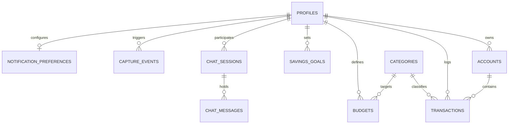

# SPENDX Database Architecture & Schema Specification

## 1. Engine & Strategy
- **Database Engine**: PostgreSQL hosted on Supabase.
- **Tenant Isolation**: Row Level Security (RLS) policies on all tables tied to `auth.uid()`.
- **Primary Keys**: UUID v4 (`gen_random_uuid()`).
- **Audit Columns**: `created_at` (TIMESTAMPTZ DEFAULT now()) and `updated_at` (TIMESTAMPTZ DEFAULT now()).

## 2. Table Schemas & Relationships



### Table 1: `profiles`
- `id` (UUID, PK) -> references `auth.users(id)` ON DELETE CASCADE
- `email` (TEXT, NOT NULL, UNIQUE)
- `full_name` (TEXT)
- `currency` (VARCHAR(3), DEFAULT 'USD')
- `avatar_url` (TEXT)
- `created_at` (TIMESTAMPTZ, DEFAULT now())
- `updated_at` (TIMESTAMPTZ, DEFAULT now())

### Table 2: `accounts`
- `id` (UUID, PK, DEFAULT gen_random_uuid())
- `user_id` (UUID, FK -> `profiles.id`, NOT NULL)
- `institution_name` (TEXT, NOT NULL)
- `account_type` (TEXT, NOT NULL) -- CHECK (account_type IN ('CHECKING', 'SAVINGS', 'CREDIT_CARD', 'INVESTMENT'))
- `account_number_mask` (VARCHAR(4))
- `balance` (NUMERIC(14, 2), NOT NULL DEFAULT 0.00)
- `created_at` (TIMESTAMPTZ, DEFAULT now())
- `updated_at` (TIMESTAMPTZ, DEFAULT now())

### Table 3: `categories`
- `id` (UUID, PK, DEFAULT gen_random_uuid())
- `user_id` (UUID, FK -> `profiles.id`, NULLABLE) -- NULL indicates system global category
- `name` (TEXT, NOT NULL)
- `icon` (TEXT)
- `color_hex` (VARCHAR(7))
- `is_system` (BOOLEAN, DEFAULT false)

### Table 4: `transactions`
- `id` (UUID, PK, DEFAULT gen_random_uuid())
- `user_id` (UUID, FK -> `profiles.id`, NOT NULL)
- `account_id` (UUID, FK -> `accounts.id`, NOT NULL)
- `category_id` (UUID, FK -> `categories.id`, NULLABLE)
- `amount` (NUMERIC(12, 2), NOT NULL)
- `type` (TEXT, NOT NULL) -- CHECK (type IN ('INCOME', 'EXPENSE', 'TRANSFER'))
- `description` (TEXT, NOT NULL)
- `merchant_name` (TEXT)
- `date` (TIMESTAMPTZ, NOT NULL)
- `is_recurring` (BOOLEAN, DEFAULT false)
- `created_at` (TIMESTAMPTZ, DEFAULT now())
- `updated_at` (TIMESTAMPTZ, DEFAULT now())

### Table 5: `budgets`
- `id` (UUID, PK, DEFAULT gen_random_uuid())
- `user_id` (UUID, FK -> `profiles.id`, NOT NULL)
- `category_id` (UUID, FK -> `categories.id`, NOT NULL)
- `allocated_amount` (NUMERIC(12, 2), NOT NULL)
- `period` (TEXT, NOT NULL) -- CHECK (period IN ('MONTHLY', 'YEARLY'))
- `month_year` (DATE, NOT NULL)
- `created_at` (TIMESTAMPTZ, DEFAULT now())

### Table 6: `savings_goals`
- `id` (UUID, PK, DEFAULT gen_random_uuid())
- `user_id` (UUID, FK -> `profiles.id`, NOT NULL)
- `name` (TEXT, NOT NULL)
- `target_amount` (NUMERIC(12, 2), NOT NULL)
- `current_amount` (NUMERIC(12, 2), DEFAULT 0.00)
- `target_date` (DATE)
- `created_at` (TIMESTAMPTZ, DEFAULT now())

### Table 7: `capture_events`
- `id` (UUID, PK, DEFAULT gen_random_uuid())
- `user_id` (UUID, FK -> `profiles.id`, NOT NULL)
- `source` (TEXT, NOT NULL) -- E.g., 'PLAID_WEBHOOK', 'CSV_IMPORT', 'EMAIL_RECEIPT'
- `raw_payload` (JSONB, NOT NULL)
- `status` (TEXT, NOT NULL) -- CHECK (status IN ('PENDING', 'PROCESSED', 'FAILED'))
- `created_at` (TIMESTAMPTZ, DEFAULT now())

### Table 8: `recurring_transactions`
- `id` (UUID, PK, DEFAULT gen_random_uuid())
- `user_id` (UUID, FK -> `profiles.id`, NOT NULL)
- `category_id` (UUID, FK -> `categories.id`, NULLABLE)
- `amount` (NUMERIC(12, 2), NOT NULL)
- `frequency` (TEXT, NOT NULL) -- CHECK (frequency IN ('WEEKLY', 'MONTHLY', 'YEARLY'))
- `merchant_name` (TEXT, NOT NULL)
- `next_expected_date` (DATE NOT NULL)
- `created_at` (TIMESTAMPTZ, DEFAULT now())

### Table 9: `financial_insights`
- `id` (UUID, PK, DEFAULT gen_random_uuid())
- `user_id` (UUID, FK -> `profiles.id`, NOT NULL)
- `type` (TEXT, NOT NULL) -- CHECK (type IN ('WARNING', 'TIP', 'MILESTONE', 'ANOMALY'))
- `title` (TEXT, NOT NULL)
- `description` (TEXT, NOT NULL)
- `actionable_step` (TEXT)
- `is_dismissed` (BOOLEAN, DEFAULT false)
- `generated_at` (TIMESTAMPTZ, DEFAULT now())

### Table 10: `chat_sessions`
- `id` (UUID, PK, DEFAULT gen_random_uuid())
- `user_id` (UUID, FK -> `profiles.id`, NOT NULL)
- `title` (TEXT, DEFAULT 'Financial Advice Session')
- `created_at` (TIMESTAMPTZ, DEFAULT now())

### Table 11: `chat_messages`
- `id` (UUID, PK, DEFAULT gen_random_uuid())
- `session_id` (UUID, FK -> `chat_sessions.id`, NOT NULL)
- `role` (TEXT, NOT NULL) -- CHECK (role IN ('USER', 'ASSISTANT', 'SYSTEM'))
- `content` (TEXT, NOT NULL)
- `token_count` (INTEGER)
- `created_at` (TIMESTAMPTZ, DEFAULT now())

### Table 12: `notification_preferences`
- `user_id` (UUID, PK -> `profiles.id`, NOT NULL)
- `budget_alerts` (BOOLEAN, DEFAULT true)
- `duplicate_warnings` (BOOLEAN, DEFAULT true)
- `ai_insights_weekly` (BOOLEAN, DEFAULT true)
- `email_notifications` (BOOLEAN, DEFAULT true)
- `updated_at` (TIMESTAMPTZ, DEFAULT now())

## 3. Indexing Strategy
- `idx_transactions_user_date`: `CREATE INDEX idx_transactions_user_date ON transactions(user_id, date DESC);`
- `idx_transactions_duplicate_check`: `CREATE INDEX idx_transactions_duplicate_check ON transactions(user_id, account_id, amount, date);`
- `idx_budgets_user_period`: `CREATE INDEX idx_budgets_user_period ON budgets(user_id, month_year);`
- `idx_chat_messages_session`: `CREATE INDEX idx_chat_messages_session ON chat_messages(session_id, created_at ASC);`

## 4. Row-Level Security (RLS) Template
```sql
ALTER TABLE transactions ENABLE ROW LEVEL SECURITY;

CREATE POLICY "Users can only view their own transactions"
ON transactions FOR SELECT
USING (auth.uid() = user_id);

CREATE POLICY "Users can only insert their own transactions"
ON transactions FOR INSERT
WITH CHECK (auth.uid() = user_id);
```
